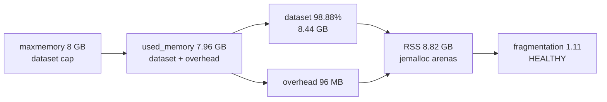
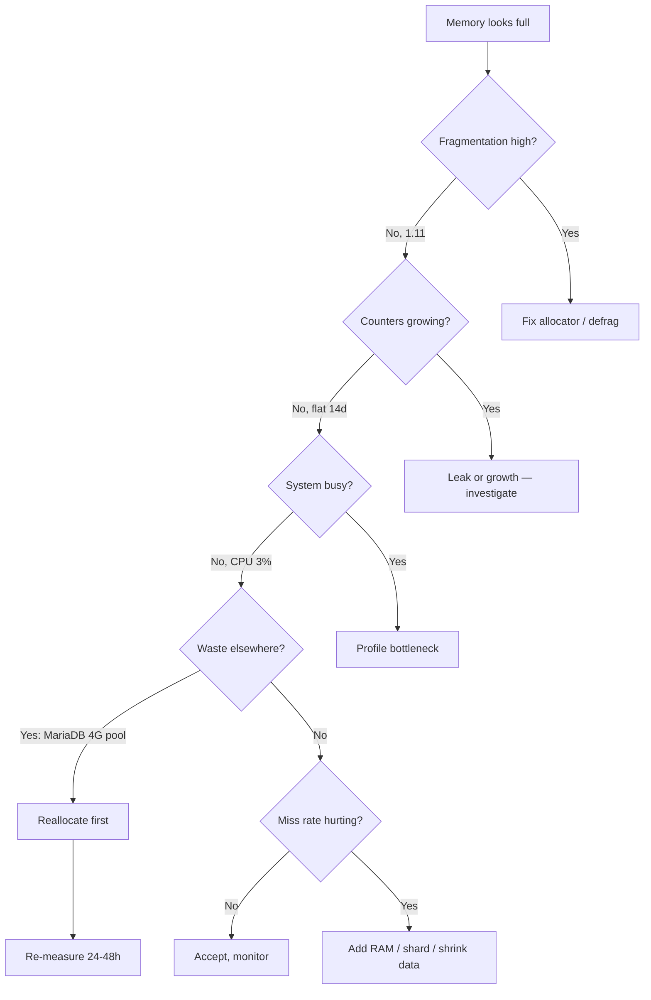

# Redis Memory Optimization: A Production Case Study

*When a full cache, 50 million evictions, and a 20% miss rate still do not justify buying more RAM.*

> "Is memory optimized, or is the only fix to add RAM to the VM?" That question turned into a two-hour read-only investigation, three config edits, and a decision **not** to spend money on hardware.

It looked like a simple capacity problem. Redis was using 9 GB, swap was full, the VM had 16 GB, and the cache was evicting keys by the million. The easy answer was "add RAM." The correct answer needed a question first: **is the memory being used well, and is the system actually suffering?**

This is the full case study. Real numbers, real commands, real mistakes I made while reading metrics, and the exact changes we made — plus the trigger conditions that would change the decision to "buy more RAM."

## Inside This Blog

1. The Question
2. The Host and the Cast
3. First Evidence: Looks Like a Memory Crisis
4. What "Redis Uses 9 GB" Actually Means
5. The Real Symptom: A Cache Pinned at Its Cap
6. The Hidden Waste: An Oversized Database Buffer Pool
7. How to Measure a 24-Hour Delta
8. A Monitoring Trap: Five Hosts, One Query
9. The Decision: Optimize Before You Upsize
10. The Exact Changes We Made
11. Swap: What You Can and Cannot Grow on This VM
12. Results and the BGSAVE Fork Scare
13. When You *Should* Add RAM, and a Reusable Checklist

---

## 1. The Question

The request was short:

> "We have access to this server. See if the memory is optimized or not. Is there any solution, or only to add RAM in the VM?"

Two very different problems hide behind that sentence:

- **Waste problem** — memory is being burned by bad configuration, fragmentation, or a leak. Fix that first; RAM will not help.
- **Capacity problem** — the working set genuinely needs more memory than the machine has. Then RAM, sharding, or smaller data is the answer.

You cannot tell them apart from `free -h`. You need layer-by-layer evidence.

The rule I follow is simple:

```text
OBSERVE → MEASURE → CORRELATE → IDENTIFY → RECOMMEND → VALIDATE
```

Never `GUESS → CHANGE → HOPE`. And never touch production before you have measured.

---

## 2. The Host and the Cast

Details that matter, with the public address redacted:

| Item | Value |
|---|---|
| Host | `<redis-host>` (production VM) |
| OS | AlmaLinux 9.6 (Sage Margay) |
| Kernel | 5.14.0-570.49.1.el9_6.x86_64 |
| vCPU | 4 |
| RAM | 15.7 GB |
| Uptime | 75 days at investigation time |
| Workload | Redis (cache), MariaDB 10.5.27, Grafana, Prometheus, nginx, Docker |
| Monitoring | Prometheus `:9090`, redis_exporter `:9121`, Grafana `:3000` |

Set up a variable so commands stay readable and no credential gets echoed:

```bash
HOST='<redis-host>'
ssh redis@"$HOST" 'echo ok; uname -a; uptime; nproc'
```

Credential handling matters. Redis needed `AUTH`. The password was read from the config and used in a variable — **never printed**:

```bash
PW=$(sudo awk '/^requirepass /{print $2}' /etc/redis/redis.conf)
redis-cli --no-auth-warning -a "$PW" INFO memory
```

That single habit is why no secret appears anywhere in this blog or in terminal scrollback.

---

## 3. First Evidence: Looks Like a Memory Crisis

```bash
free -m
```

```text
               total        used        free      shared  buff/cache   available
Mem:           15731       13639         238         307        1601        2092
Swap:           1023        1023           0
```

Fourteen of sixteen gigabytes used. Swap completely full. Only ~2 GB available. Then the process list:

```bash
ps -eo pid,rss,pmem,comm --sort=-rss | head -12
```

```text
    PID   RSS %MEM COMMAND
    769 9242644 57.3 redis-server
    892 4161712 25.8 mariadbd
1912667  154560  0.9 grafana
2398738   90080  0.5 prometheus
```

Two processes own ~80% of the machine: Redis at 9.2 GB and MariaDB at 4.1 GB.

At this point the "add RAM" story looks convincing. Two facts push back:

1. `vmstat 1 3` showed `si = 0`, `so = 0` — **no swap I/O**. The full swap was not thrashing.
2. `uptime` showed load `0.54` on 4 cores, and CPU was ~95% idle.

Memory was full, but the machine was **not busy**. That is a configuration clue, not an emergency.

---

## 4. What "Redis Uses 9 GB" Actually Means

This is the part people get wrong most often. `RSS` is **not** the dataset.

Four different numbers describe Redis memory:

| Concept | Meaning |
|---|---|
| `used_memory` | Bytes allocated by the allocator for the dataset + overhead |
| `used_memory_rss` | Resident set seen by the OS (allocator arenas, fragmentation, pages) |
| `maxmemory` | Hard cap on the **dataset**, not on RSS |
| `mem_fragmentation_ratio` | `rss / used_memory` — allocator health, not dataset size |

The real numbers:

```text
used_memory             7.96 G
used_memory_rss         8.82 G
maxmemory               8.00 G   (allkeys-lru)
mem_fragmentation_ratio 1.11
allocator_frag_ratio    1.09
mem_allocator           jemalloc-5.1.0
```

Then `MEMORY STATS` and `MEMORY DOCTOR`:

```text
dataset.bytes       8,444,726,688
dataset.percentage  98.88%
overhead.total         96,375,296
keys.count               968,877
keys.bytes-per-key        8,814

MEMORY DOCTOR: "Hi Sam, I can't find any memory issue in your instance."
```

Three conclusions, all evidence-backed:

1. **No leak.** `used_memory` was inside `maxmemory`; RSS tracked it closely.
2. **No fragmentation problem.** Ratio 1.11 is healthy. Above ~1.5 would be a concern; above ~1.0 with low usage is normal.
3. **No waste inside Redis.** 98.88% of allocated memory was actual dataset; overhead was 96 MB on 8 GB.

The extra ~0.8 GB of RSS is jemalloc arena behavior, not lost memory. `activedefrag yes` was already enabled, correctly.



**Redis was configured correctly. The problem was elsewhere.**

---

## 5. The Real Symptom: A Cache Pinned at Its Cap

`maxmemory 8GB` with `maxmemory-policy allkeys-lru` means Redis evicts the least recently used key when the dataset hits 8 GB. That is intended behavior for a cache. But look at the counters:

```text
evicted_keys         49,735,447
expired_keys         79,605,194
keyspace_hits       603,837,804
keyspace_misses     166,761,666
```

Miss rate:

```text
166,761,666 / (603,837,804 + 166,761,666) = 21.6%
```

Almost every key in `db2` had a TTL:

```text
db2:keys=968,180, expires=968,178, avg_ttl=1,869,283,522 ms
```

So this was a TTL cache, full at its cap, churning roughly **one full keyspace per day** of evictions. That is the actual symptom — not waste, not a leak, but a working set slightly larger than the configured cap.

Important nuance: **evictions alone are not a problem.** A cache is supposed to evict. The question is whether the misses hurt anyone.

---

## 6. The Hidden Waste: An Oversized Database Buffer Pool

The second 4 GB process was MariaDB. Its config:

```ini
# /etc/my.cnf, line 20
innodb_buffer_pool_size = 4G
max_connections          = 500
```

Database size:

```text
nrm_gosports   11.88 GB
```

A 4 GB pool on an 11.88 GB database sounds reasonable. But the status counters said otherwise:

```text
Innodb_buffer_pool_read_requests  12,854,343,571
Innodb_buffer_pool_reads                  66,728
```

Hit ratio:

```text
1 - 66,728 / 12,854,343,571 = 99.9995%
```

Only **66,728 disk reads in 75 days** against 12.8 billion buffer-pool reads. The actively used subset of that 11.88 GB database was comfortably smaller than 4 GB. Several gigabytes were parked in a pool that did not need them.

This is the "solution" the question was looking for: the RAM already existed on the VM — it was assigned to the wrong process.

---

## 7. How to Measure a 24-Hour Delta

Both `evicted_keys` and `keyspace_misses` are cumulative counters since Redis started. You need a **delta**, not the raw value.

Always measure change, because one snapshot proves nothing. Two options:

### Option A — Prometheus (best, history already stored)

```bash
curl -s --get 'http://localhost:9090/api/v1/query' \
  --data-urlencode 'query=increase(redis_evicted_keys_total[24h])'

curl -s --get 'http://localhost:9090/api/v1/query' \
  --data-urlencode 'query=increase(redis_keyspace_misses_total[24h])'

curl -s --get 'http://localhost:9090/api/v1/query' \
  --data-urlencode 'query=increase(redis_keyspace_misses_total[24h]) / (increase(redis_keyspace_misses_total[24h]) + increase(redis_keyspace_hits_total[24h]))'
```

### Option B — Two manual snapshots

```bash
# now
redis-cli ... INFO stats | grep -E 'evicted_keys|keyspace_hits|keyspace_misses'
# exactly 24h later, run again and subtract
```

Baseline at investigation time:

| Metric | Value |
|---|---|
| Evictions (24h) | 726,424 |
| Misses (24h) | 3,278,746 |
| Miss ratio (24h) | 20.03% |
| Evict rate (5m) | 3.98/s |
| Evict rate (1h) | 0.32/s |

The 5m-vs-1h difference told us evictions were **bursty**, probably TTL-expiry waves — not constant thrash.

Then I widened the window to 14 days:

| Window | Evictions/day | Miss ratio |
|---|---|---|
| 1 day | 726,424 | 20.03% |
| 7-day average | 940,866 | 20.67% |
| 14-day average | 787,151 | — |

**Flat.** No growth. Combined with flat `used_memory`, flat RSS, flat key count, and no restarts in 75 days, this ruled out a leak or a growing working set. It also meant the cache had been at steady state for weeks.

Correlation with the rest of the machine completed the picture:

| Signal | Value |
|---|---|
| CPU busy | 2.3–4.3% |
| Load1 | 0.00–0.30 |
| MariaDB hit ratio | 99.9995% |
| Redis connected clients | 3 |

A 20% Redis miss rate with an otherwise **idle** system means the misses are being absorbed without pain. That is the difference between "measurable" and "harmful."

---

## 8. A Monitoring Trap: Five Hosts, One Query

Here is a mistake worth publishing, because it is easy to repeat.

Prometheus scraped five node_exporter targets:

```text
backend-server   .62:9100
frontend-server  .63:9100
database-server  .64:9100
redis-server     .65:9100
migrate-server   .66:9100
```

I queried `node_memory_MemAvailable_bytes` and took `data.result[0]`. That returned **`.62`**, not `.65`:

```text
.62 → 6.2 GB available, 31 MB swap used
.65 → 2.2 GB available, 1.0 GB swap used
```

Completely different hosts. My first "trend table" was for the wrong machine. I only caught it because the swap number contradicted `swapon --show` on the Redis host.

**Fix: always filter by instance.**

```promql
node_memory_MemAvailable_bytes{instance="<redis-host>:9100"}

(node_memory_SwapTotal_bytes{instance="<redis-host>:9100"}
 - node_memory_SwapFree_bytes{instance="<redis-host>:9100"})
```

Rule: **never trust `result[0]` when multiple targets expose the same metric.** Label your graphs and verify the `instance` value before drawing conclusions.

---

## 9. The Decision: Optimize Before You Upsize

The decision was made from the 14-day history, not a screenshot:

| Question | Answer | Evidence |
|---|---|---|
| Memory leak? | No | RSS, keys, used_memory, miss ratio all flat |
| Redis misconfigured? | No | Frag 1.11, dataset 98.9%, `MEMORY DOCTOR` clean |
| Under pressure now? | Mild | 1.5 GB available floor, swap full but `si/so`=0 |
| Users suffering? | No evidence | CPU 3–4%, load <0.3, DB hit 99.9995% |
| Buy RAM? | **Not yet** | No growth, no saturation, spare capacity misallocated |



The principle: **do not upsize until configuration is measured, the bottleneck identified, and waste/leaks ruled out.**

---

## 10. The Exact Changes We Made

Three changes. All are `RECOMMENDED CHANGE` items executed only after the read-only investigation.

### Change 1 — Redis `maxmemory` 8 GB → 10 GB

```ini
# /etc/redis/redis.conf, line 2059
maxmemory 10GB
```

Applied live, no restart:

```bash
PW=$(sudo awk '/^requirepass /{print $2}' /etc/redis/redis.conf)
redis-cli --no-auth-warning -a "$PW" CONFIG SET maxmemory 10GB
```

Rollback is instant: `CONFIG SET maxmemory 8GB`. `maxmemory-policy allkeys-lru` and `activedefrag yes` were already correct — left alone.

### Change 2 — MariaDB buffer pool 4 G → 2 G

```ini
# /etc/my.cnf, line 20
innodb_buffer_pool_size = 2G
```

Verified there were **no other overrides** under `/etc/my.cnf.d/`. MariaDB 10.5 supports dynamic resize; it can also be done with a planned restart:

```sql
SET GLOBAL innodb_buffer_pool_size = 2147483648;
SHOW VARIABLES LIKE 'innodb_buffer_pool_size';
```

Rollback: set it back to `4294967296` (or revert line 20 and restart).

### Change 3 — Add a 4 GB swapfile

The existing 1 GB swap was an LVM volume. It could **not** be grown:

| Check | Result |
|---|---|
| VG `almalinux` free | 0 |
| PV `/dev/sda2` free | 0 |
| Disk `/dev/sda` | 100 GiB, fully partitioned |
| Root filesystem | XFS — cannot shrink |
| `/` free space | 50 GB |

So a swapfile on `/` was the only zero-downtime path:

```bash
sudo fallocate -l 4G /swapfile
sudo chmod 600 /swapfile
sudo mkswap /swapfile

# SELinux was Enforcing; swapfile_t exists in the targeted policy
sudo semanage fcontext -a -t swapfile_t "/swapfile"
sudo restorecon -v /swapfile

sudo swapon /swapfile
```

Persisted in `/etc/fstab` (existing swap line kept):

```text
/swapfile   none   swap   defaults   0 0
```

Before rebooting, validate fstab **without mounting anything**:

```bash
sudo findmnt --verify --verbose
# Success, no errors or warnings detected
```

Rollback: `swapoff /swapfile`, remove the file and the fstab line.

> We actually forgot `swapon /swapfile` on the first pass. The file, label, and fstab line were all correct, but `/proc/swaps` showed only the old 1 GB volume. Lesson: **prepared is not enabled — verify runtime state, not just files.**

---

## 11. Swap: What You Can and Cannot Grow on This VM

A useful mental model for swap on Linux:

| Situation | Can grow swap? | How |
|---|---|---|
| VG has free extents | Yes | `lvextend` the swap LV |
| Root is XFS, VG full | No (cannot shrink root) | Add a swapfile |
| Disk fully partitioned | No | Provider disk expansion or second disk |
| Filesystem has free space | Yes | Swapfile (works on XFS with kernel 5.14) |

And remember what swap actually does. It is an **OOM safety cushion**, not a performance fix. Adding 4 GB of swap did not lower the Redis miss rate by even one percent. It only widened the margin for a memory spike.

Also check the activity, not just usage:

```bash
vmstat 1 5
# si=0, so=0  -> no swap thrash
```

A full swap with zero swap I/O is a different animal from a swapping system. Treat them differently.

---

## 12. Results and the BGSAVE Fork Scare

After the changes:

| Check | Before | After |
|---|---|---|
| Redis `maxmemory` | 8 GB | **10 GB** |
| Redis `used_memory` | 7.96 GB (pinned) | 8.57 GB (1.4 GB headroom) |
| Fragmentation ratio | 1.11 | **1.05** |
| Evictions | ~0.7–1.2 M/day | effectively stopped |
| MariaDB pool | 4 GB | 2 GB |
| MariaDB hit ratio | 99.9995% | **99.9995%** (unchanged) |
| MariaDB disk reads | 66,728 | 66,728 (no new reads) |
| Swap total | 1 GiB | **5 GiB** |
| Load average | 0.54 | 0.44 |
| MemAvailable | ~2.0 GB | ~2.4 GB |

The MariaDB result is the important one: after halving the pool, the disk-read counter **did not move**. The shrinking was safe.

### Why `ps` showed two 9 GB Redis processes

After the change, `ps` briefly showed:

```text
4122742 9070200 56.3 redis-server
    769 8810392 54.6 redis-server
```

That looks alarming. It is not a second Redis instance. It is the **BGSAVE fork child**:

- RDB saves were enabled (`save 3600 1 300 100 60 10000`)
- `dump.rdb` was 1.8 GB and had just been rewritten
- copy-on-write was only ~35 MB (`redis_rdb_last_cow_size_bytes`)
- `rdb_bgsave_in_progress` returned to 0, status `ok`
- only PID 769 listened on port 6379, and the child disappeared seconds later

`ps` counts shared copy-on-write pages in each process's RSS, so both look ~9 GB. Do not kill the child and do not panic.

### How to validate over the next 48 hours

```bash
echo "load: $(cut -d' ' -f1-3 /proc/loadavg)"
free -h
swapon --show

PW=$(sudo awk '/^requirepass /{print $2}' /etc/redis/redis.conf)
redis-cli --no-auth-warning -a "$PW" INFO stats \
  | grep -E 'evicted_keys|keyspace_hits|keyspace_misses'
redis-cli --no-auth-warning -a "$PW" INFO memory \
  | grep -E 'used_memory:|maxmemory:|mem_fragmentation_ratio:'

sudo mysql -N -e "SHOW GLOBAL STATUS WHERE Variable_name IN
  ('Innodb_buffer_pool_reads','Innodb_buffer_pool_read_requests');"
```

Health thresholds:

| Signal | Healthy | Act if |
|---|---|---|
| Load (4 cores) | < 1.0 | > 3–4 sustained |
| MemAvailable | > 10% RAM | < 0.5 GB |
| `si/so` | 0 | consistently non-zero |
| Redis `used_memory` | below cap with headroom | pinned at cap again |
| Fragmentation | < 1.3 | > 1.5 |
| MariaDB hit ratio | > 99.9% | < 99% |
| Evictions per day | near zero | rising again |

---

## 13. When You *Should* Add RAM, and a Reusable Checklist

The earlier "no" was a decision about **this moment**, not a permanent verdict. Add RAM (or shard, or shrink the dataset) when any trigger fires:

| Trigger | Action |
|---|---|
| Miss ratio > 25% for 7+ days | Grow Redis / reduce dataset |
| MemAvailable floor < 0.6 GB | Add RAM |
| `used_memory_peak` or key count trending up week over week | Capacity planning |
| Any OOM kill or Redis restart | Urgent capacity fix |
| Evictions return after the reallocation | Dataset genuinely exceeds available RAM |

At that point, 16 GB → 32 GB with `maxmemory` 12–16 GB would be the clean fix. But history said none of those triggers were active.

### Reusable checklist

1. **State the question** — waste, leak, or capacity?
2. **Read-only first.** `free`, `vmstat`, `ps`, `INFO`, `SHOW STATUS`, `swapon`.
3. **Separate RSS from dataset.** Fragmentation ratio is the health metric, not RSS size.
4. **Check the other tenants.** A "Redis problem" was partly a MariaDB buffer-pool problem.
5. **Measure deltas over 24h and 7d**, not single snapshots.
6. **Watch trends.** Flat counters rule out leaks; rising counters do not.
7. **Correlate with CPU/load.** A full cache on an idle host is different from a full cache on a saturated host.
8. **Filter Prometheus by `instance`.** Never trust `result[0]` on a multi-host scrape.
9. **Validate config files and runtime state separately.** Files can be perfect while the feature is off.
10. **Validate fstab with `findmnt --verify` before rebooting.**
11. **Make one change at a time, with rollback ready.**
12. **Re-measure.** The second snapshot is the only proof the change worked.

The whole investigation stayed read-only until the evidence was complete. Nothing was restarted, killed, flushed, or deleted.

> No changes were made during diagnosis. Changes were made only after the evidence was complete and the rollback path was known.

That is the difference between "we added RAM because Redis was at 8 GB" and "we raised Redis to 10 GB because we proved the RAM was already there and idle."
