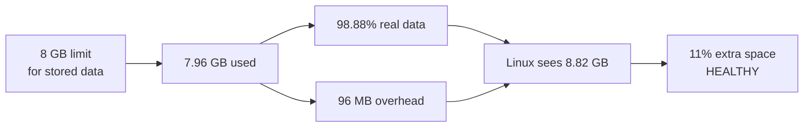
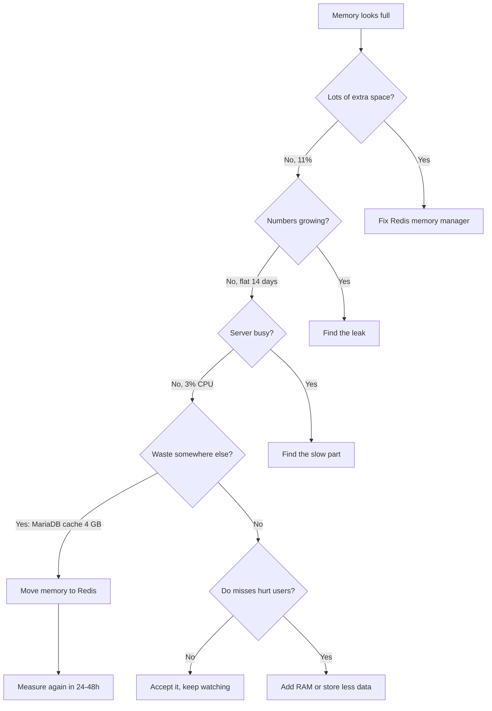

# How We Fixed Redis Memory Without Adding RAM

*One server, 16 GB of memory, a full Redis cache, and a lesson in looking before buying.*

> Someone asked: "Is memory being used well, or should we just add more RAM?" We spent two hours reading numbers. Then we changed three settings. We did not buy RAM.

The server looked full. Redis was using about 9 GB. Swap was full. The cache was throwing away millions of keys. The easy answer was "buy more memory."

We asked a better question first: **Is anything actually broken, and is memory being wasted somewhere else?**

The answer was no to the first question and yes to the second.

This is the whole story, told in plain words. Real numbers, real commands, one mistake we made while reading the charts, and the exact changes we made.

## What is inside

1. The question
2. The server
3. What we saw first
4. Why "Redis uses 9 GB" was not the whole story
5. The real problem: old keys were being thrown away
6. The wasted memory: MariaDB's cache was too big
7. How we measured one day
8. A mistake: we looked at the wrong server
9. Our decision
10. The three changes we made
11. What swap can and cannot do here
12. What happened after
13. When you really should add RAM
14. Simple rules you can reuse

---

## 1. The question

The request was short:

> "See if memory is optimized, or if the only fix is to add RAM to the VM."

Two different problems hide in that sentence:

- **Memory is being wasted.** Bad settings or a bug are eating space. Fix that first. More RAM would not help.
- **The server really needs more memory.** The data is bigger than the machine. Then you buy RAM, split the data, or store less.

You cannot tell them apart by looking at free memory alone. You have to look layer by layer.

Our rule: **look first, measure next, decide last.** Do not change things production runs on until you know what is wrong.

---

## 2. The server

Details, with the public address hidden:

| Item | Value |
|---|---|
| Machine | `<redis-host>` (production server) |
| System | AlmaLinux 9.6 |
| Processor | 4 CPUs |
| Memory | 16 GB |
| Running for | 75 days without a restart |
| Main programs | Redis (cache), MariaDB (database), Grafana, Prometheus, nginx |
| Charts | Prometheus, redis_exporter, Grafana |

We used a variable so commands stay short and no password shows up:

```bash
HOST='<redis-host>'
ssh redis@"$HOST" 'echo ok; uname -a; uptime; nproc'
```

Redis needed a password. We read it from the config file into a variable and never printed it:

```bash
PW=$(sudo awk '/^requirepass /{print $2}' /etc/redis/redis.conf)
redis-cli --no-auth-warning -a "$PW" INFO memory
```

That is why no secret appears in this post.

---

## 3. What we saw first

```bash
free -m
```

```text
               total        used        free      shared  buff/cache   available
Mem:           15731       13639         238         307        1601        2092
Swap:           1023        1023           0
```

Almost all 16 GB was used. Swap was completely full. Only about 2 GB was free. Then we listed the biggest memory users:

```bash
ps -eo pid,rss,pmem,comm --sort=-rss | head -12
```

```text
    PID   RSS %MEM COMMAND
    769 9242644 57.3 redis-server
    892 4161712 25.8 mariadbd
1912667  154560  0.9 grafana
2398738   90080  0.5 prometheus
```

Two programs owned almost everything: Redis with 9.2 GB and MariaDB with 4.1 GB.

At this point "buy more RAM" sounds right. Two things made us pause:

1. Swap was full, but the server was not actually swapping. `vmstat` showed `si = 0` and `so = 0`.
2. The server was almost idle. Load was `0.54` on 4 CPUs, and the processors were 95% free.

Memory was full, but the server was not working hard. That means settings, not a shortage.

---

## 4. Why "Redis uses 9 GB" was not the whole story

Most people read the 9 GB number and stop. But Redis and Linux count memory in different ways.

| Number | What it really means |
|---|---|
| `used_memory` | Memory Redis uses for stored data plus its own small costs |
| `used_memory_rss` | Memory Linux sees for the Redis process |
| `maxmemory` | The limit Redis puts on **stored data**, not on the Linux number |
| `mem_fragmentation_ratio` | How much extra space Redis's memory manager is holding |

The real numbers:

```text
used_memory             7.96 G
used_memory_rss         8.82 G
maxmemory               8.00 G
mem_fragmentation_ratio 1.11
```

The ratio `1.11` means about 11% extra space. That is fine. A bad number would be 1.5 or higher.

Then we asked Redis itself if it saw a problem:

```text
dataset.bytes       8,444,726,688
dataset.percentage  98.88%
overhead.total         96,375,296
keys.count               968,877
keys.bytes-per-key        8,814

MEMORY DOCTOR: "I can't find any memory issue in your instance."
```

Almost all memory (98.88%) was real stored data. Only 96 MB was overhead. No leak. No mess.



**Redis was set up correctly.** The answer had to be somewhere else.

---

## 5. The real problem: old keys were being thrown away

Redis was told: "When you reach 8 GB, throw away the key that was used longest ago." That is normal for a cache. But look at the counters:

```text
evicted_keys         49,735,447
expired_keys         79,605,194
keyspace_hits       603,837,804
keyspace_misses     166,761,666
```

Out of every 10 lookups, about **2 failed** because the key was gone:

```text
166,761,666 / (603,837,804 + 166,761,666) = 21.6%
```

Almost every key had an expiry time. So this was a temporary cache, full at its 8 GB limit, throwing away roughly one whole set of keys every day.

But here is the important part: **throwing away keys is not bad by itself.** Caches are supposed to do that. The question is whether users felt it.

---

## 6. The wasted memory: MariaDB's cache was too big

The other big user was MariaDB. Its setting:

```ini
# /etc/my.cnf, line 20
innodb_buffer_pool_size = 4G
```

This is memory MariaDB keeps for table data so it does not read the disk often. The database was 11.88 GB, so 4 GB sounded reasonable.

But the counters told a different story:

```text
Innodb_buffer_pool_read_requests  12,854,343,571
Innodb_buffer_pool_reads                  66,728
```

MariaDB found the data in memory **99.9995%** of the time. In 75 days it only read from disk 66,728 times out of 12.8 billion requests.

The part of the database people actually use was much smaller than 4 GB. Several gigabytes were sitting unused.

**This was the answer.** The memory was already on the server. It was just given to the wrong program.

---

## 7. How we measured one day

Both Redis counters keep adding up since the server started. One reading tells you nothing. You need the difference between two readings.

The easy way: we already had Prometheus saving the numbers.

```bash
curl -s --get 'http://localhost:9090/api/v1/query' \
  --data-urlencode 'query=increase(redis_evicted_keys_total[24h])'

curl -s --get 'http://localhost:9090/api/v1/query' \
  --data-urlencode 'query=increase(redis_keyspace_misses_total[24h])'

curl -s --get 'http://localhost:9090/api/v1/query' \
  --data-urlencode 'query=increase(redis_keyspace_misses_total[24h]) / (increase(redis_keyspace_misses_total[24h]) + increase(redis_keyspace_hits_total[24h]))'
```

Plain English: "how many keys were thrown away in the last day" and "what share of lookups failed in the last day."

What we got:

| Number | Value |
|---|---|
| Keys thrown away in 24h | 726,424 |
| Failed lookups in 24h | 3,278,746 |
| Failed lookups share | 20.03% |
| Throwing-away rate now | 4 per second |

Then we looked back 14 days:

| Time window | Keys thrown away per day | Failed lookups share |
|---|---|---|
| Last 1 day | 726,424 | 20.03% |
| 7-day average | 940,866 | 20.67% |
| 14-day average | 787,151 | — |

**Flat.** No growth. Same as it had been for weeks. Stored data was flat too. Key count was flat. The server had not restarted in 75 days.

That rules out a leak or a growing problem.

Then we checked whether the misses hurt anything:

| Number | Value |
|---|---|
| Processor use | 2.3–4.3% |
| Load | 0.00–0.30 |
| MariaDB cache success | 99.9995% |
| Redis users connected | 3 |

A 20% cache miss on an almost idle server is not hurting anyone. It is a number worth watching, not a fire to fight.

---

## 8. A mistake: we looked at the wrong server

This one is worth sharing.

Prometheus watched five servers. When we asked for memory numbers, we took the first answer it gave. That answer came from a different server, not Redis.

| Server | Free memory it reported | Swap it reported |
|---|---|---|
| Wrong server | 6.2 GB | 31 MB |
| Redis server | 2.2 GB | 1.0 GB |

Our first table was about the wrong machine. We only noticed because the swap number did not match what `swapon --show` said on the Redis server.

The fix is simple: always say which server you mean.

```promql
node_memory_MemAvailable_bytes{instance="<redis-host>:9100"}
```

**Never trust the first result when many servers report the same number.** Check the machine name on every chart.

---

## 9. Our decision

| Question | Answer | Why |
|---|---|---|
| Memory leak? | No | Numbers flat for 14 days |
| Redis badly set up? | No | Only 11% extra space, Redis says it is fine |
| Server struggling? | No | Processors nearly idle |
| Users suffering? | No sign | Database still answers from memory almost always |
| Buy RAM? | **Not yet** | Memory is free on the server, just in the wrong place |



Rule: **do not buy a bigger server until you have measured the one you have.**

---

## 10. The three changes we made

### Change 1 — Give Redis more room: 8 GB → 10 GB

```ini
# /etc/redis/redis.conf, line 2059
maxmemory 10GB
```

No restart needed. Redis can change this while running:

```bash
PW=$(sudo awk '/^requirepass /{print $2}' /etc/redis/redis.conf)
redis-cli --no-auth-warning -a "$PW" CONFIG SET maxmemory 10GB
```

To undo: `CONFIG SET maxmemory 8GB`. The other settings were already right, so we left them.

### Change 2 — Give MariaDB less: 4 GB → 2 GB

```ini
# /etc/my.cnf, line 20
innodb_buffer_pool_size = 2G
```

We checked first that no other file changed this setting. MariaDB can also change it while running:

```sql
SET GLOBAL innodb_buffer_pool_size = 2147483648;
SHOW VARIABLES LIKE 'innodb_buffer_pool_size';
```

To undo: set it back to `4294967296`, or put back line 20 and restart MariaDB.

### Change 3 — Add 4 GB of swap as a safety net

The old swap was 1 GB and could not be made bigger:

| Check | Result |
|---|---|
| Extra disk space in the disk group | 0 |
| Disk fully used up | Yes |
| Disk type | Cannot give space back |
| Free space in the main folder | 50 GB |

So we made a file and told Linux to use it as swap:

```bash
sudo fallocate -l 4G /swapfile
sudo chmod 600 /swapfile
sudo mkswap /swapfile

# Security was on, so the file needed the right label
sudo semanage fcontext -a -t swapfile_t "/swapfile"
sudo restorecon -v /swapfile

sudo swapon /swapfile
```

To keep it after a restart, we added one line to `/etc/fstab`:

```text
/swapfile   none   swap   defaults   0 0
```

Before any restart, check the file is correct:

```bash
sudo findmnt --verify --verbose
# Success, no errors or warnings detected
```

To undo: `swapoff /swapfile`, delete the file, remove the fstab line.

> We forgot `swapon /swapfile` the first time. The file, label, and fstab line were all correct, but swap was still only 1 GB. **A file being ready is not the same as it being on. Always check the running state.**

---

## 11. What swap can and cannot do here

| Situation | Can you grow swap? | How |
|---|---|---|
| Extra space in disk group | Yes | Make the swap volume bigger |
| Disk cannot shrink, group is full | No | Use a swap file |
| Disk completely full | No | Ask provider for more disk |
| Main folder has free space | Yes | Swap file works here |

Swap is a **safety net**, not a speed fix. Adding 4 GB of swap did not change the failed-lookup number at all. It only gives the server more room if memory suddenly spikes.

Also check activity, not just usage:

```bash
vmstat 1 5
# si=0, so=0 means it is not actually swapping
```

Full swap with no swapping is very different from a server that is swapping nonstop. Do not treat them the same.

---

## 12. What happened after

| Check | Before | After |
|---|---|---|
| Redis limit | 8 GB | **10 GB** |
| Redis stored data | 7.96 GB, stuck at limit | 8.57 GB, 1.4 GB free |
| Extra space | 11% | **5%** |
| Keys thrown away | 0.7–1.2 million per day | almost none |
| MariaDB cache | 4 GB | 2 GB |
| MariaDB cache success | 99.9995% | **99.9995%**, unchanged |
| MariaDB disk reads | 66,728 | 66,728, no new reads |
| Swap | 1 GB | **5 GB** |
| Load | 0.54 | 0.44 |
| Free memory | about 2.0 GB | about 2.4 GB |

The MariaDB line is the important one. After we cut its cache in half, the disk-read number did not move. The change was safe.

### Why two Redis processes showed up

After the change, `ps` showed two Redis processes, each around 9 GB:

```text
4122742 9070200 56.3 redis-server
    769 8810392 54.6 redis-server
```

That looks scary. It is not a second Redis.

Redis was saving a copy of its data to disk. To do this safely, it makes a second process that shares the same data until something changes. Both processes appear to use 9 GB because they point at the same pages.

Facts that proved it was harmless:

- The save finished fine
- The save file was 1.8 GB
- Only about 35 MB actually changed during the save
- Only one process listened on port 6379
- The second process disappeared seconds later

Do not kill it. It is normal.

### How to check over the next two days

```bash
echo "load: $(cut -d' ' -f1-3 /proc/loadavg)"
free -h
swapon --show

PW=$(sudo awk '/^requirepass /{print $2}' /etc/redis/redis.conf)
redis-cli --no-auth-warning -a "$PW" INFO stats \
  | grep -E 'evicted_keys|keyspace_hits|keyspace_misses'
redis-cli --no-auth-warning -a "$PW" INFO memory \
  | grep -E 'used_memory:|maxmemory:|mem_fragmentation_ratio:'

sudo mysql -N -e "SHOW GLOBAL STATUS WHERE Variable_name IN
  ('Innodb_buffer_pool_reads','Innodb_buffer_pool_read_requests');"
```

| Number | Fine | Worry when |
|---|---|---|
| Load on 4 CPUs | under 1.0 | over 3–4 for a long time |
| Free memory | over 1.5 GB | under 0.5 GB |
| Actual swapping | 0 | happens all the time |
| Extra space in Redis | under 1.3 | over 1.5 |
| MariaDB cache success | over 99.9% | under 99% |
| Keys thrown away daily | near zero | climbing again |

---

## 13. When you really should add RAM

Our "not yet" was about this moment, not forever. Add memory, split the data, or store less when:

| Sign | What to do |
|---|---|
| Failed lookups over 25% for 7 days | Give Redis more room or store less |
| Free memory stays under 0.6 GB | Add RAM |
| Stored data keeps growing each week | Plan for more space |
| Any crash or Redis restart | Fix capacity urgently |
| Keys get thrown away again after the changes | The data really is too big |

If that happens, 16 GB → 32 GB with a Redis limit of 12–16 GB would be the clean fix. None of those signs were present, so we did not spend money.

---

## 14. Simple rules you can reuse

1. **Ask what kind of problem it is.** Waste, bug, or not enough room?
2. **Look without changing anything first.**
3. **Do not treat "Redis uses 9 GB" as the whole story.** Two tools count memory differently.
4. **Check the other programs.** What looked like a Redis problem was partly a database setting.
5. **Compare one day with seven days.** One reading proves nothing.
6. **Look at the trend.** Flat numbers mean no leak.
7. **Check if the server is busy.** A full cache on an idle server is different from a full cache on a struggling one.
8. **Make sure charts are for the right machine.**
9. **Check files and running state separately.** A perfect config file can still be switched off.
10. **Check the fstab file before restarting.**
11. **Change one thing at a time and know how to undo it.**
12. **Measure again after the change.** The second reading is the only proof.

We did not restart, kill, delete, or clear anything while investigating. We changed things only after we had the evidence and a way back.

> Diagnosis changed nothing. Changes came later, only after we knew what was wrong and how to undo it.

That is the whole difference. We did not add RAM because Redis was at 8 GB. We raised Redis to 10 GB because we proved the memory was already there, idle, and in the wrong hands.
